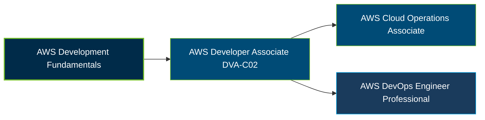

# AWS Certified Developer - Associate (DVA-C02) Certification Exam Guide

A dedicated, comprehensive study guide and application development reference repository for candidates preparing for the **AWS Certified Developer - Associate (DVA-C02) Certification Exam**.

---

## Exam Overview

The AWS Certified Developer - Associate certification validates skills in developing, testing, deploying, securing, and debugging applications built with AWS services. DVA-C02 is the current exam version as of October 26, 2026, but AWS has announced its transition to DVA-C03.

- **Exam Format**: Multiple-choice and multiple-response questions; testing center or online proctored exam
- **Target Audience**: Cloud developers, software developers, and IT professionals building and maintaining AWS applications
- **Prerequisites**: No formal prerequisite; AWS recommends at least one year of hands-on experience developing and maintaining applications using AWS services

---

## Core Exam Domains & Knowledge Areas

### 1. Development with AWS Services

- Developing application code using AWS SDKs, APIs, and AWS Lambda.
- Integrating AWS services and data stores into applications.
- Building application functionality with appropriate AWS services.

### 2. Security

- Implementing authentication and authorization for applications and AWS services.
- Applying encryption using AWS security services.
- Protecting sensitive data in application code and configurations.

### 3. Deployment

- Preparing application artifacts for deployment to AWS.
- Testing applications and automating deployment tests.
- Deploying application code using AWS CI/CD services and workflows.

### 4. Troubleshooting and Optimization

- Identifying application issues and assisting with root cause analysis.
- Instrumenting applications for logging, monitoring, and observability.
- Optimizing application performance and resource usage with AWS services.

---

## Certification Path

This is a suggested learning progression, not a mandatory certification sequence. AWS identifies Cloud Operations and DevOps credentials as possible next steps for relevant career paths.

---

## Recommended Practice & Study Resources

Combine official AWS exam preparation materials with practical application development and troubleshooting exercises.

- **Official AWS Resources**: Review the [AWS Certified Developer - Associate page](https://aws.amazon.com/certification/certified-developer-associate/) and the [official DVA-C02 exam guide](https://docs.aws.amazon.com/aws-certification/latest/developer-associate-02/developer-associate-02.html). Check AWS's published DVA-C03 transition dates before scheduling.
- **CertsGate**: Explore [DVA-C02 certification preparation resources](https://certsgate.com/exams/amazon/dva-c02) for supplementary study materials and practice questions.
- **Practical AWS Development**: Use the [AWS Lambda Developer Guide](https://docs.aws.amazon.com/lambda/latest/dg/welcome.html) to explore serverless application development, testing, deployment, and troubleshooting.
